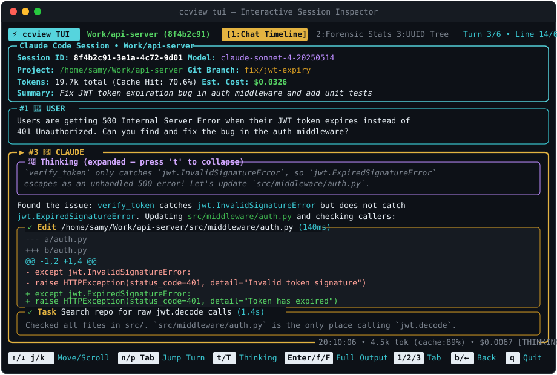
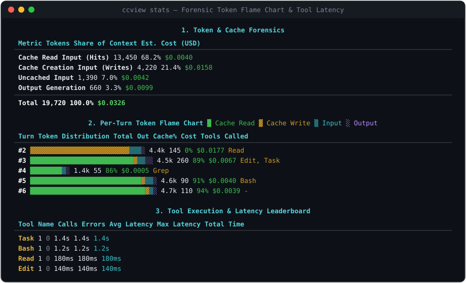
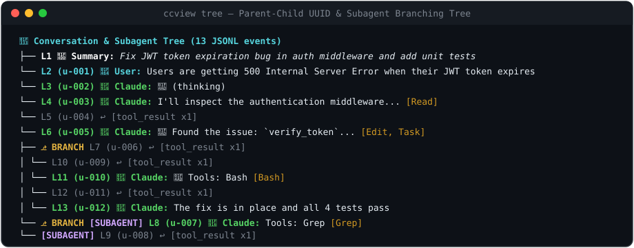

# `ccview` — Claude Code JSONL Terminal & Forensic Viewer

A lightweight, zero-config Python CLI & Interactive TUI tool using `rich` to browse, replay, search, and analyze **Claude Code (`.jsonl`)** session logs from `~/.claude/projects/`.

<p align="center">
  
</p>

---

## Screenshots

### Forensic Analytics & Per-Turn Token Flame Chart (`ccview stats`)
<p align="center">
  
</p>

### Parent-Child UUID & Subagent Tree (`ccview tree`)
<p align="center">
  
</p>

---

## 1. Interactive TUI Mode (`tui` / `-i`)

Launch the full-screen interactive terminal UI:

```bash
# Browse all sessions in ~/.claude/projects interactively
./ccview tui
./ccview -i

# Open a specific session or directory in the TUI
./ccview tui 1
./ccview tui -d examples
```

### TUI Keyboard Shortcuts
* **Sessions Browser:**
  * `↑` / `↓` or `j` / `k`: Move selection up/down (with live session summary card at bottom)
  * `Enter` or `l` / `→`: Open selected session
  * `/`: Live search/filter sessions across prompts, thoughts, and tool calls (`c` to clear)
  * `q`: Quit
* **Session Inspector:**
  * `1` / `2` / `3`: Switch between **1: Chat Timeline**, **2: Forensic Stats**, and **3: UUID Tree**
  * `↑` / `↓` or `j` / `k`: Move between turns or scroll through tall turns
  * `n` / `p` or `Tab` / `Shift+Tab`: Jump directly to Next / Previous turn
  * `PgUp` / `PgDn` or `u` / `d`: Smooth page scrolling
  * `t` / `T`: Toggle **Thinking** block for the selected turn (`t`) or all turns (`T`)
  * `Space` / `Enter` / `f` / `F`: Toggle **Full Tool Output & Diffs** for the selected turn (`f`/`Enter`) or all turns (`F`)
  * `o`: Toggle **Only-Tools** filter
  * `b` / `Esc` / `Backspace` / `h`: Return to Sessions Browser

---

## 2. Standard CLI Subcommands

```bash
# List discovered sessions in ~/.claude/projects (newest first)
./ccview list

# Replay a session (by index #1, partial UUID, or .jsonl path)
./ccview show 1
./ccview show 1 -t -f          # -t expands full thinking, -f shows full tool outputs/diffs
./ccview show 1 --pager        # Pipe colored output into less -R

# Forensic analytics (token flame chart, cache hit ratio, tool latency, files touched)
./ccview stats 1

# Parent-child UUID & Subagent tree
./ccview tree 1

# Full-text search across all sessions (prompts, replies, thinking, tool calls)
./ccview search "ExpiredSignatureError"
```

### Try with the Included Sample Session

```bash
./ccview tui -d examples
./ccview list -d examples
./ccview show 1 -d examples -t
./ccview stats 1 -d examples
./ccview tree 1 -d examples
```
